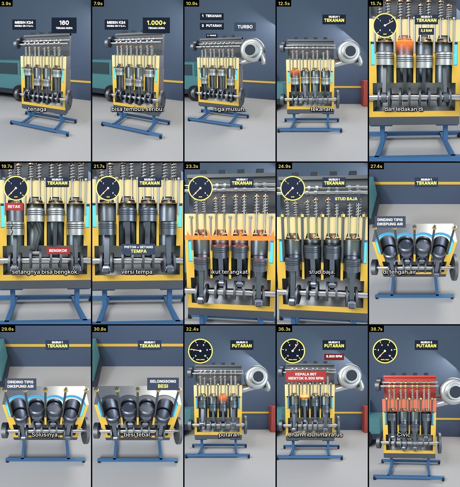
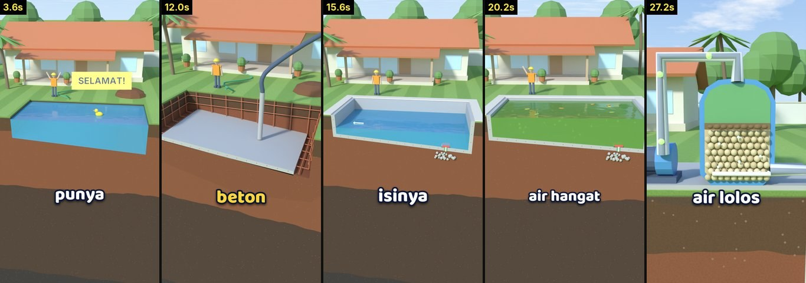
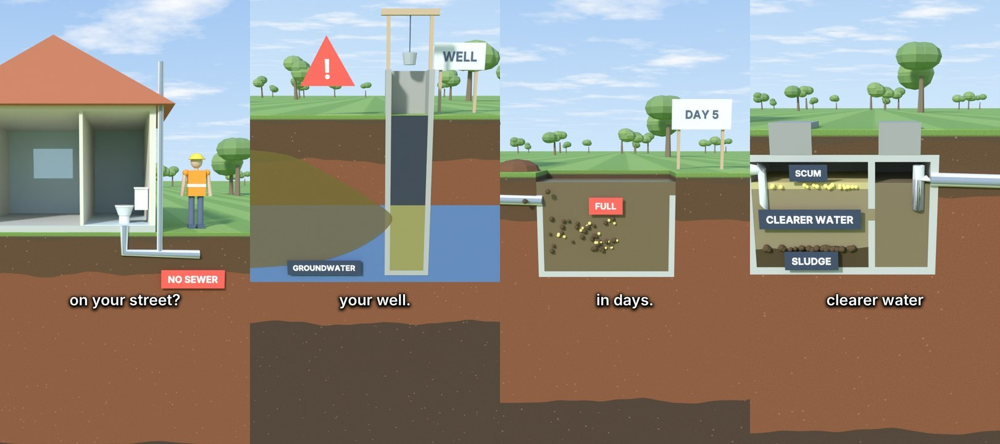

# 3D Engineering Video — skill Claude untuk short penjelasan teknik 3D

Tiga skill untuk Claude dan satu kit kode yang membuat video pendek vertikal (9:16, 60–75 detik) tentang cara kerja benda atau sistem teknik: gambar potongan 3D dibangun dari kode Blender, narasi dari suara AI, caption muncul per kata, dan semua gerak mengikuti waktu kata di narasi.

Alur ini sudah dipakai untuk tiga video: "How a Septic System Works" (Inggris), "Cara kerja kolam renang" (Indonesia), dan "Mesin CR-V tembus seribu tenaga kuda" (Indonesia, dibuat dari video referensi berbahasa Inggris).

*English summary: three Claude skills (written in Indonesian) plus a Python/Blender kit that turn a script or a reference short into a narrated 3D cutaway explainer video. Claude writes the scene as code, Higgsfield provides the AI voice and a rented GPU for rendering. It works with English scripts too.*

## Yang bisa dibuat

| Kamu memberi | Claude membuat |
|---|---|
| Naskah bahasa Indonesia | video berbahasa Indonesia; naskahmu dipakai apa adanya |
| Naskah bahasa Inggris | video berbahasa Inggris |
| Video referensi (Inggris atau Indonesia) | video baru dalam bahasa sebaliknya, dengan naskah yang ditulis ulang dari fakta yang dicek |
| Topik saja | Claude meriset, menulis naskah, lalu membuat videonya |

## Yang kamu butuhkan

1. **Claude dengan skill dan eksekusi kode aktif.** Skill berjalan di workspace Linux milik Claude; di komputermu tidak perlu ada Blender atau GPU. Lihat [Use skills in Claude](https://support.claude.com/en/articles/12512180).
2. **Akun Higgsfield berlangganan yang punya kredit, terhubung ke Claude sebagai konektor MCP.** Higgsfield dipakai untuk suara (ElevenLabs v4), sandbox pengolah audio, dan sewa GPU untuk render. Cara menghubungkannya ada di [halaman MCP Higgsfield](https://higgsfield.ai/mcp) dan [pusat bantuannya](https://higgsfield.ai/creator-hub/help-center/integrations/how-do-i-connect-higgsfield-to-claude).

Tidak ada API key yang perlu dipasang: Higgsfield tersambung lewat konektor dengan login akunmu sendiri.

## Memasang

1. Hubungkan Higgsfield ke Claude (tautan di atas).
2. Unduh tiga berkas ZIP di folder [`dist/`](dist/), satu untuk tiap skill.
3. Di Claude buka **Customize > Skills**, pilih **+**, lalu **Create skill > Upload a skill**, dan unggah ZIP itu satu per satu. Aktifkan ketiganya. Rincian langkahnya ada di [artikel bantuan Claude](https://support.claude.com/en/articles/12512180).

Kit kode tidak perlu dipasang sendiri. Saat pertama dipakai, skill mengambilnya dari repo ini dengan `git clone` dan memasang Blender sebagai modul Python di workspace Claude (±1 GB, beberapa menit).

Kalau kamu mem-fork repo ini, ganti alamat repo di ketiga `SKILL.md` dan di `kit/README.md` dengan alamat fork-mu, lalu buat ulang ZIP dengan `python3 dist/make_dist.py`.

## Memakai

Tulis permintaan seperti biasa, misalnya:

- "Buat video 3D engineering dari naskah ini: …"
- "Make a 3D engineering video from this script: …"
- (dengan video terlampir) "Pelajari video ini, lalu buat video serupa dalam bahasa Indonesia."

Urutan kerjanya:

1. Claude merapikan naskah, mengecek faktanya, dan menyusun rancangan gambar.
2. Claude berhenti dan meminta persetujuanmu atas batas kredit. Sebelum titik ini tidak ada kredit yang terpakai.
3. Suara dibuat, waktu tiap kata diukur, scene ditulis sebagai kode dan diperiksa lewat still di CPU dan pemeriksa scene tanpa render.
4. GPU disewa, semua frame dirender dan diperiksa otomatis, caption dibakar, hasil diunggah, GPU dimatikan.
5. Kamu menerima link video final, master bersih tanpa caption dan suara, dan laporan biaya.

## Biaya

Dalam kredit Higgsfield, terukur pada November 2026. Harga bisa berubah; Claude mengeceknya lagi sebelum meminta persetujuan.

| Video | Suara | GPU | Total | Catatan |
|---|---|---|---|---|
| #1, 66 detik | 4,37 | 43,72 | 48,09 | sekali render |
| #2, 68,4 detik | 16,66 | 132,29 | 148,95 | termasuk audisi suara, satu render yang dibuang (±33), dan satu render ulang sebagian (±20) |
| #3, 75,9 detik | 6,44 | 110,90 | 117,34 | satu take suara; termasuk dua render ulang sebagian (±26) |

Perkiraan untuk video ±70 detik tanpa kerja ulang: 75–85 kredit GPU (L40S, 71 kredit per jam) ditambah ±6 kredit per take suara. Dua dari tiga video butuh render ulang sebagian, jadi sediakan batas ±1,6 kali perkiraan.

## Isi repo

| Folder | Isi |
|---|---|
| [`skills/`](skills/) | tiga `SKILL.md`: `3d-engineering-video` (alur utama), `reference-short-teardown` (membedah video referensi), `higgsfield-blender-render` (render di GPU sewaan) |
| [`dist/`](dist/) | ZIP tiap skill, siap diunggah ke Claude |
| [`kit/`](kit/) | kode: pembangun scene Blender, caption, alat suara, skrip render dan QA. Mulai dari [`kit/README.md`](kit/README.md) dan [`kit/GUIDE.md`](kit/GUIDE.md) |
| [`examples/`](examples/) | tiga job nyata: skrip scene, naskah, waktu per kata, cek fakta |
| [`docs/`](docs/) | catatan produksi ketiga video, dua contoh hasil bedah video referensi, dan runbook (riwayat cara kerja dan daftar jebakan) |

## Yang perlu kamu tahu sebelum memakai

- **Masih muda.** Baru tiga video yang dibuat dengan alur ini, dan hanya yang ketiga memakai kit dan skill dari awal sampai akhir. Kit 1.1 memuat pelajaran video itu; dua skrip yang diubah di 1.1 baru diuji di CPU. Mengambil kit dengan `git clone` dari repo ini belum pernah dipakai dalam produksi.
- **Kerja ulang itu biasa.** Dua dari tiga video butuh render ulang sebagian karena kesalahan animasi yang baru terlihat setelah render penuh. Pemeriksa scene di kit 1.1 dibuat untuk menangkap jenis kesalahan itu sebelum GPU disewa.
- **Claude tidak mendengar dan tidak menonton.** Yang diperiksa adalah frame diam dan hasil ukur (format, kenyaringan, sinkron kata). Dengarkan dan tonton sendiri hasilnya sebelum diunggah.
- **Hanya narasi.** Musik dan efek suara tidak dibuat; master bersih disediakan untuk itu.
- **Video referensi tidak disalin.** Yang diikuti hanya formatnya (durasi, tempo, gaya caption, pola kamera). Naskah ditulis baru dari fakta yang dicek sendiri; footage, audio, dan karakter video referensi tidak dipakai.
- **Satu format.** 1080×1920, 30 fps.
- **Lingkungan yang diuji.** Aplikasi Claude dengan workspace cloud dan konektor Higgsfield MCP. Claude Code dan API belum diuji.

## Keamanan

Repo ini tidak memuat kredensial, token, atau data akun. Saat produksi, Claude membuat URL unggah sekali pakai di akun Higgsfield-mu; URL itu hanya hidup di box render dan tidak boleh disimpan di repo atau dokumen (`.gitignore` sudah menyingkirkan `urls.sh`).

## Lisensi dan kredit

Lisensi [GPL-3.0-or-later](LICENSE). © 2026 David Alfa Sunarna. Kode dan dokumen ditulis bersama Claude (Anthropic).

Lisensi GPL dipilih karena skrip scene memanggil API Python Blender, dan Blender meminta skrip semacam itu dibagikan dengan lisensi yang sesuai GPL ([Blender license](https://www.blender.org/about/license/)). Lisensi ini mengatur kode dan dokumen di repo, bukan video yang kamu buat dengannya; untuk suara dan render berlaku ketentuan layanan Higgsfield.

Blender (`bpy`), ffmpeg, faster-whisper, serta font Inter dan Baloo 2 dipasang atau diunduh saat dipakai dan tidak disertakan di repo. Higgsfield dan ElevenLabs adalah layanan pihak ketiga dengan ketentuannya sendiri. Proyek ini tidak berafiliasi dengan Anthropic, Higgsfield, ElevenLabs, atau Blender Foundation.
