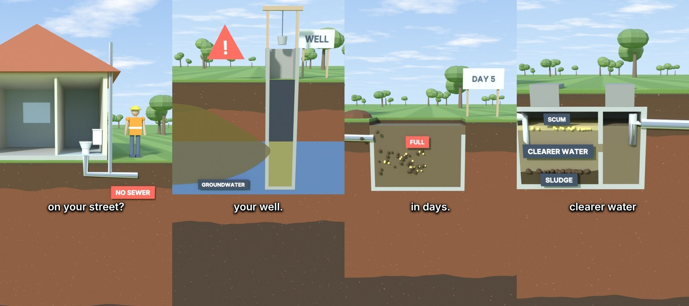
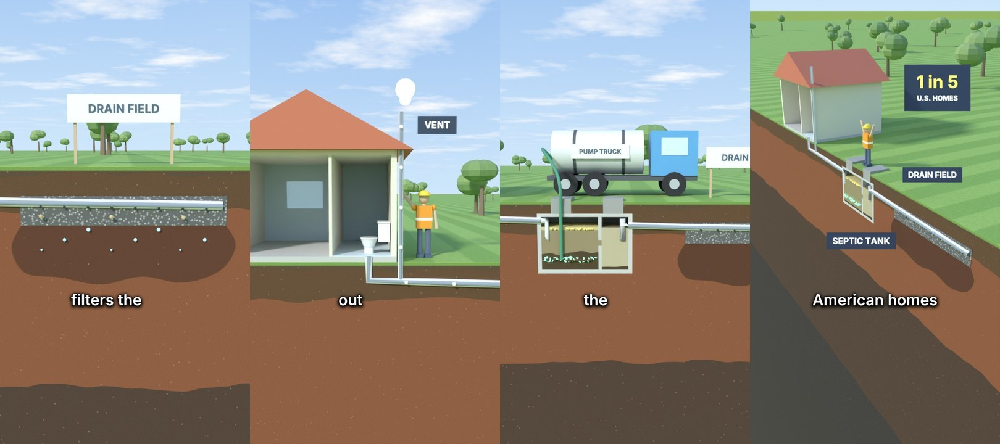

# Example 01: How a Septic System Works (EN)

A 9:16 short, 1080x1920, 30 fps, 66 seconds, with English narration, phrase captions that fill in word by word, and a hard camera cut per beat. This is the first video, made before the kit existed: `septic_video.py` is standalone (902 lines) and is the source of the functions in `kit/explainer_kit.py`.




## Contents

| File | Contents |
|---|---|
| `septic_video.py` | the whole scene and animation, 710 objects. The word timings of the narration are embedded in the `WORDS` list |
| `script_en.md` | the script, the picture for each line, the caption phrases with their timings, the fact check with sources, and the deliberate simplifications |
| `job.env`, `script.txt`, `words.json` | job files for `kit/captions.py` in the `phrases` style. The ` / ` marks in `script.txt` set the phrase breaks; the result is 66 phrases with the same text and timing as the original video |
| `preview/` | contact sheets from the CPU preview render, with captions |

The audio file is not included.

## Try it without credits

```bash
cp -r examples/video01-septic-system-en ~/jobs/septic && bash kit/newjob.sh ~/jobs/septic && cd ~/jobs/septic
python3 septic_video.py still 540 960 16 st 21.3 37.6 61.5       # stills at those seconds, on CPU
python3 captions.py test st/t_03760.png 37.6 st/c_03760.png      # a phrases-style caption on top of a still
python3 septic_video.py blend 1080 1920 64 septic.blend          # save the scene to open in Blender 5.3
```

This script does not use `job.env` and has no `list` mode, so it does not work with the `kit/box/` scripts. For a new video, start from `kit/scene_template.py` or from example 02, and read this script for hard cuts, labels on the cut face, and the truck.

## Production numbers (21 November 2026)

| Item | Value |
|---|---|
| Render | 1,980 frames, Cycles with OptiX at 64 samples + denoise, 1x rented L40S, 3 parallel processes: 27 minutes 20 seconds |
| Voice | ElevenLabs v4 through Higgsfield, preset "Cillian", 171 words, 64.4 seconds |
| Higgsfield credits | voice 4.37 + GPU 43.72 = 48.09 |

The full record is in [`docs/video01-production-record.md`](../../docs/video01-production-record.md).

## Limits

- Narration only; no music or sound effects.
- Some captions appear 0.3 to 0.5 seconds before their word (the word "and" after a comma). The cause has been fixed in `kit/audio/align.py` v1.0; the `words.json` here is deliberately left as it was in production.
- This video was rendered with Cycles persistent data turned on. The kit now turns it off, because in the second video that option corrupted some of the frames.
