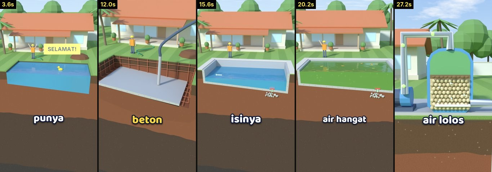
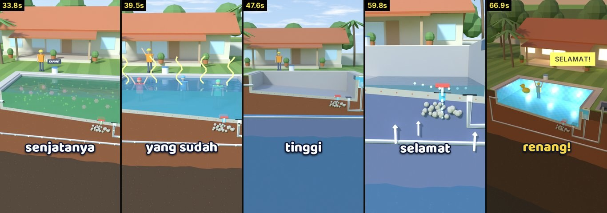

# Contoh 02 — Cara kerja kolam renang (ID)

Short 9:16, 1080×1920, 30 fps, 68,4 detik, narasi bahasa Indonesia, caption 1–2 kata per kartu, satu gerak kamera sinambung. Folder ini adalah job kit v1.0 yang lengkap kecuali suaranya: scene yang dibangun dari sini sama persis dengan video yang diproduksi (834 objek, 14.240 kunci animasi).




## Isi

| Berkas | Isi |
|---|---|
| `job.env` | nama keluaran, skrip scene, bahasa `id`, gaya caption `cards`, ekor 1,62 detik |
| `script.txt` | naskah per kalimat-gambar (`S01\|teks`), 188 kata |
| `keywords.txt` | kata yang tampil kuning di caption |
| `words.json` | waktu mulai dan selesai tiap kata pada narasi yang sudah diolah |
| `pool_video.py` | seluruh scene dan animasi; tiap gerak diikat ke kata narasi lewat `T('S06', 'Pompa')` |
| `script_id.md` | naskah dengan waktu, gambar per baris, cek fakta, sumber, dan penyederhanaan yang disengaja |
| `preview/` | contact sheet dari render pratinjau CPU dengan caption |

File suara tidak disertakan. Untuk membuat videonya utuh, buat narasi dari `script.txt` (lihat `kit/GUIDE.md` bagian 3), lalu ambil ulang `words.json` dari narasi itu; animasinya menyesuaikan sendiri.

## Mencoba tanpa kredit

```bash
cp -r examples/video02-kolam-renang-id ~/jobs/kolam && bash kit/newjob.sh ~/jobs/kolam && cd ~/jobs/kolam
python3 pool_video.py still 270 480 4 st 3.6 27.2 47.6          # tiga still kecil di CPU
python3 captions.py test st/t_02720.png 27.2 st/c_02720.png     # caption di atas still
python3 pool_video.py blend 1080 1920 64 pool.blend             # simpan scene untuk dibuka di Blender 5.3
```

## Angka produksi (22 November 2026)

| Hal | Nilai |
|---|---|
| Scene | 834 objek, 517 baris Python + kit 470 baris |
| Render | 2.052 frame, Cycles OptiX 64 sampel + denoise, 1× L40S sewaan, 3 proses paralel: 46 menit 25 detik |
| Suara | ElevenLabs v4 lewat Higgsfield, preset "Marcus", tag tempo `[quick, energetic pace]`; 78,4 detik mentah → 66,5 detik setelah diolah |
| Kredit Higgsfield | suara 16,66 + GPU 132,29 = 148,95, termasuk satu render yang dibuang dan satu render ulang sebagian |

Cerita lengkapnya, termasuk dua cacat yang ditemukan scan frame, ada di [`docs/video02-production-record.md`](../../docs/video02-production-record.md). Bedah video referensinya ada di [`docs/video02-reference-analysis.md`](../../docs/video02-reference-analysis.md).

## Batas

- Hanya narasi; tanpa musik dan efek suara.
- Suara dipilih dari ukuran (tempo, jeda, jumlah kata yang dikenali mesin transkripsi), bukan dari telinga.
- Dengan `align.py` v1.0, dua kata ("Lima" di S10 dan "Katup" di S11) seharusnya mulai ±0,25 detik lebih lambat daripada di `words.json` ini. Berkas ini sengaja dibiarkan sama dengan produksi.
