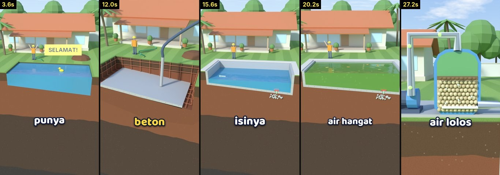
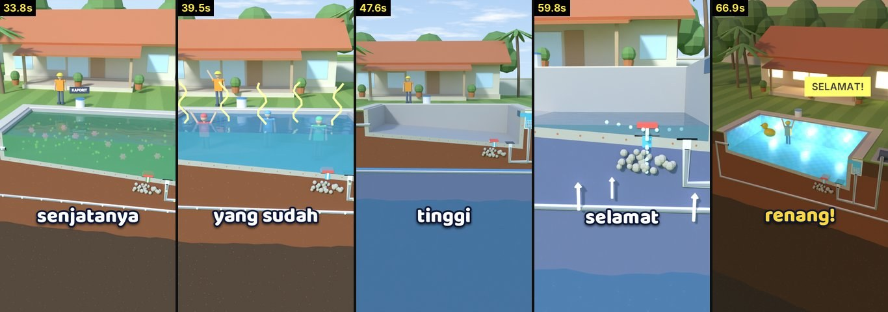

# Example 02: Cara kerja kolam renang (how a swimming pool works, ID)

A 9:16 short, 1080x1920, 30 fps, 68.4 seconds, with Indonesian narration, captions of one or two words per card, and one continuous camera move. This folder is a complete kit job except for the audio: the scene built from it is identical to the one in the produced video (834 objects, 14,240 animation keys).




## Contents

| File | Contents |
|---|---|
| `job.env` | output name, scene script, language `id`, caption style `cards`, a tail of 1.62 seconds |
| `script.txt` | the script, one line per sentence-picture (`S01\|text`), 188 words, in Indonesian |
| `keywords.txt` | the words shown in yellow in the captions |
| `words.json` | start and end time of every word in the processed narration |
| `pool_video.py` | the whole scene and animation; every motion is tied to a word of the narration through calls such as `T('S06', 'Pompa')` |
| `script_id.md` | the script with timings and an English gloss, the picture for each line, the fact check, the sources, and the deliberate simplifications |
| `preview/` | contact sheets from the CPU preview render, with captions |

The audio file is not included. To make the whole video, generate the narration from `script.txt` (see `kit/GUIDE.md` section 3), then take `words.json` again from that narration. The animation adjusts itself.

## Try it without credits

```bash
cp -r examples/video02-swimming-pool-id ~/jobs/pool && bash kit/newjob.sh ~/jobs/pool && cd ~/jobs/pool
python3 pool_video.py still 270 480 4 st 3.6 27.2 47.6          # three small stills on CPU
python3 captions.py test st/t_02720.png 27.2 st/c_02720.png     # caption on top of a still
python3 pool_video.py blend 1080 1920 64 pool.blend             # save the scene to open in Blender 5.3
```

## Production numbers (22 November 2026)

| Item | Value |
|---|---|
| Scene | 834 objects, 517 lines of Python plus a 470-line kit |
| Render | 2,052 frames, Cycles with OptiX at 64 samples + denoise, 1x rented L40S, 3 parallel processes: 46 minutes 25 seconds |
| Voice | ElevenLabs v4 through Higgsfield, preset "Marcus", pace tag `[quick, energetic pace]`; 78.4 seconds raw, 66.5 seconds after processing |
| Higgsfield credits | voice 16.66 + GPU 132.29 = 148.95, including one discarded render and one partial re-render |

The full story, including the two defects that the frame scan found, is in [`docs/video02-production-record.md`](../../docs/video02-production-record.md). The teardown of its reference video is in [`docs/video02-reference-analysis.md`](../../docs/video02-reference-analysis.md).

## Limits

- Narration only; no music or sound effects.
- The voice was chosen from measurements (pace, pauses, how many words the transcription engine recognised), not by ear.
- With `align.py` v1.0, two words ("Lima" in S10 and "Katup" in S11) should start about 0.25 seconds later than they do in this `words.json`. The file is deliberately left as it was in production.
