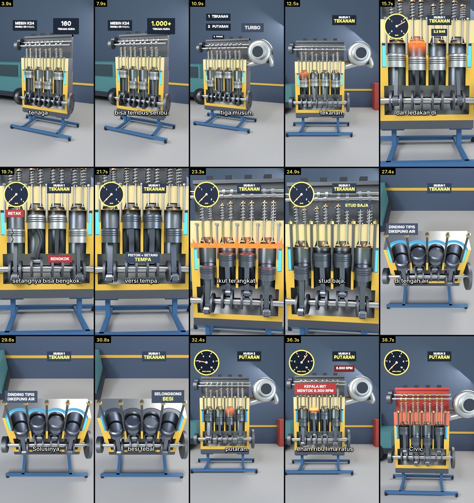
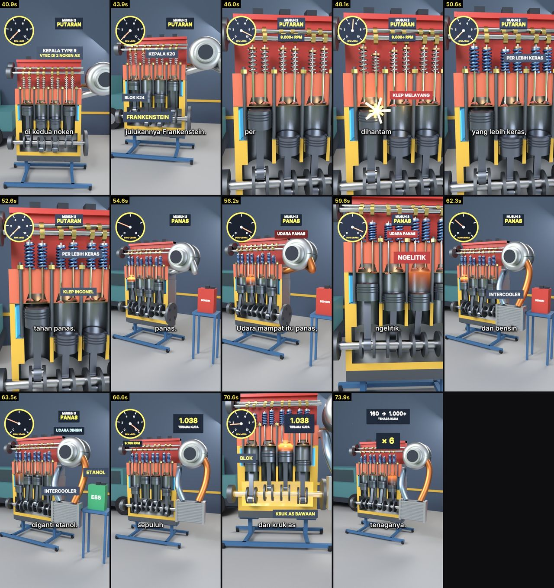

# Example 03: Mesin CR-V tembus seribu tenaga kuda (how a CR-V engine reaches 1,000 hp, ID)

A 9:16 short, 1080x1920, 30 fps, 75.9 seconds, with Indonesian narration, phrase captions that fill in word by word, and one continuous camera move. It is the first production that used the kit and all three skills from start to finish, and it was made from an English reference video: the script was rewritten from checked facts, not translated. This folder is a complete kit job except for the audio. The scene built from it is the same as the one that was rendered (771 objects, 262,404 animation keys).




The contact sheets above come from the CPU previews made before the render, with captions.

## Contents

| File | Contents |
|---|---|
| `job.env` | output name, scene script, language `id`, caption style `phrases`, a tail of 1.6 seconds |
| `script.txt` | the script, one line per sentence-picture (`S01\|text`), 199 words, in Indonesian; ` / ` marks the phrase breaks of the captions (80 phrases) |
| `words.json` | start and end time of every word in the processed narration |
| `patch_words.py` | the timing correction for the word "CR-V" in two places; it has already been applied to this `words.json` and is included as an example |
| `engine_video.py` | the whole scene and animation (484 lines): a sectioned four-cylinder engine, on-screen gauges, part swaps |
| `check_scene.py` | a checker specific to this video: valve-to-piston clearance, engine speed in each section, which parts are fitted when. The general checker is `kit/scene_check.py` |
| `script_id.md` | the script with timings and an English gloss, the picture for each line, the fact check, the sources, and the deliberate simplifications |
| `preview/` | contact sheets from the CPU previews |

The audio file is not included. To make the whole video, generate the narration from `script.txt` (see `kit/GUIDE.md` section 3), then take `words.json` again from that narration. The animation adjusts itself.

## What the script shows how to do

| Pattern | Where |
|---|---|
| One crank-angle curve for the whole video; pistons, rods, valves, springs, camshafts and flames are baked per frame from that angle | `bake`, `bake_input`, the section "one crank-angle curve for the whole video" |
| Landing an event exactly on a word without the engine turning backwards | `land` |
| A boolean cut baked into the mesh, with the cut face then painted | `carve`, `paint_section` |
| Numbers and needles fixed to the screen | `hud_label`, `dial`, `needle`, `frame` |
| Tags in the world whose size follows the camera distance | `tag` |
| Swapping parts in place (cast pistons for forged ones, the cylinder head) | `lift_away`, `drop_in`, the section "cues: who is on the engine when" |

These functions still live in this script and are not in the kit yet.

## Try it without credits

```bash
cp -r examples/video03-crv-engine-id ~/jobs/engine && bash kit/newjob.sh ~/jobs/engine && cd ~/jobs/engine
python3 scene_check.py engine_video.py                           # about 30 seconds: scene size, camera, on-screen label timetable, flashes
python3 engine_video.py still 405 720 8 st 3.0 16.0 48.0 66.5    # four stills on CPU, about 15 seconds each
python3 captions.py test st/t_01600.png 16.0 st/c_01600.png      # caption on top of a still
```

## Production numbers (23 November 2026)

| Item | Value |
|---|---|
| Scene | 771 objects, 71 materials, 484 lines of Python on top of kit v1.0 |
| Previews | 6 rounds of CPU stills and motion strips, no credits |
| Render | 2,277 frames, Cycles with OptiX at 64 samples + denoise, 1x rented L40S, 3 parallel processes: 63 minutes 25 seconds (0.60 frames per second) |
| Voice | ElevenLabs v4 through Higgsfield, preset "Marcus", pace tag `[quick, energetic pace]`, one take: 78.5 seconds raw, 74.0 seconds after processing |
| Higgsfield credits | voice 6.44 + GPU 110.90 = 117.34, including two partial re-renders (about 26) |

The full story, including two mistakes that were found only after the full render, is in [`docs/video03-production-record.md`](../../docs/video03-production-record.md). The teardown of its reference video is in [`docs/video03-reference-analysis.md`](../../docs/video03-reference-analysis.md).

## Limits

- Narration only; no music or sound effects.
- The model is diagram-like, far simpler than the model in the reference video, and has no motion blur.
- The voice was accepted from measurements (pace, how many words the transcription engine recognised), not by ear. Words the transcription engine wrote differently: "CR-V", "stud", "VTEC-nya", "noken as", "Inconel".
- The figure of 160 hp is the specification for the US and Japanese markets; the Indonesian variant has not been checked.
