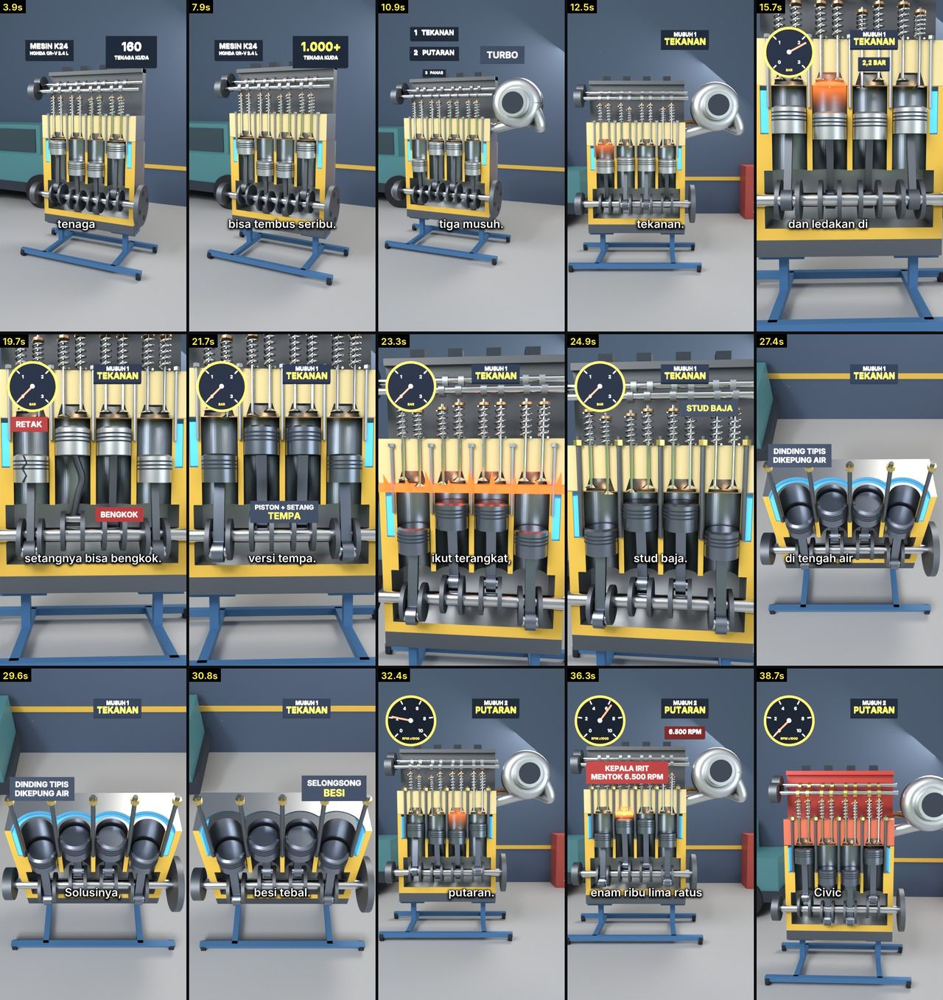
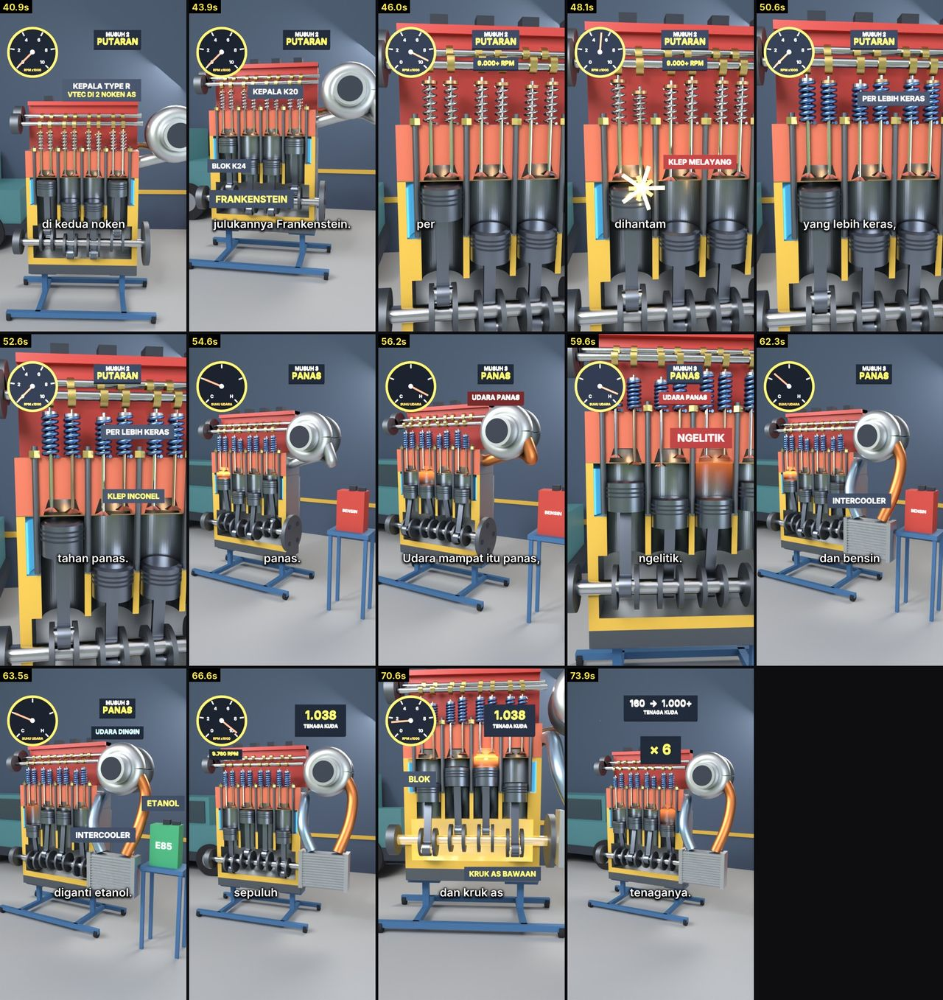

# Contoh 03 — Mesin CR-V tembus seribu tenaga kuda (ID)

Short 9:16, 1080×1920, 30 fps, 75,9 detik, narasi bahasa Indonesia, caption frasa yang terisi kata demi kata, satu gerak kamera sinambung. Ini produksi pertama yang memakai kit dan ketiga skill dari awal sampai akhir, dan dibuat dari video referensi berbahasa Inggris: naskahnya ditulis ulang dari fakta yang dicek, bukan diterjemahkan. Folder ini adalah job kit yang lengkap kecuali suaranya; scene yang dibangun dari sini sama dengan yang dirender (771 objek, 262.404 kunci animasi).




Contact sheet di atas berasal dari pratinjau CPU sebelum render, dengan caption.

## Isi

| Berkas | Isi |
|---|---|
| `job.env` | nama keluaran, skrip scene, bahasa `id`, gaya caption `phrases`, ekor 1,6 detik |
| `script.txt` | naskah per kalimat-gambar (`S01\|teks`), 199 kata; ` / ` menandai jeda frasa caption (80 frasa) |
| `words.json` | waktu mulai dan selesai tiap kata pada narasi yang sudah diolah |
| `patch_words.py` | pembetulan waktu kata "CR-V" di dua tempat; sudah diterapkan pada `words.json` ini, disertakan sebagai contoh |
| `engine_video.py` | seluruh scene dan animasi (484 baris): mesin empat silinder berpotongan, alat ukur di layar, pertukaran komponen |
| `check_scene.py` | pemeriksa khusus video ini: celah klep-piston, kecepatan mesin per bagian, komponen mana yang terpasang kapan. Pemeriksa umumnya `kit/scene_check.py` |
| `script_id.md` | naskah dengan waktu, gambar per baris, cek fakta, sumber, dan penyederhanaan yang disengaja |
| `preview/` | contact sheet pratinjau CPU |

File suara tidak disertakan. Untuk membuat videonya utuh, buat narasi dari `script.txt` (lihat `kit/GUIDE.md` bagian 3), lalu ambil ulang `words.json` dari narasi itu; animasinya menyesuaikan sendiri.

## Yang bisa dipelajari dari skripnya

| Pola | Di mana |
|---|---|
| Satu kurva sudut engkol untuk seluruh video; piston, setang, klep, per, noken as, dan nyala dipanggang per frame dari sudut itu | `bake`, `bake_input`, bagian "one crank-angle curve for the whole video" |
| Menjatuhkan kejadian tepat pada sebuah kata tanpa mesin berputar mundur | `land` |
| Potongan boolean yang dipanggang ke mesh, lalu bidang potongnya diwarnai | `carve`, `paint_section` |
| Angka dan jarum yang menempel di layar | `hud_label`, `dial`, `needle`, `frame` |
| Tag di dunia yang ukurannya mengikuti jarak kamera | `tag` |
| Menukar komponen di tempat (piston cor ke tempa, kepala silinder) | `lift_away`, `drop_in`, bagian "cues: who is on the engine when" |

Fungsi-fungsi itu masih berada di skrip ini, belum di kit.

## Mencoba tanpa kredit

```bash
cp -r examples/video03-mesin-crv-id ~/jobs/mesin && bash kit/newjob.sh ~/jobs/mesin && cd ~/jobs/mesin
python3 scene_check.py engine_video.py                           # ±30 detik: ukuran scene, kamera, jadwal label layar, kilat
python3 engine_video.py still 405 720 8 st 3.0 16.0 48.0 66.5    # empat still di CPU, ±15 detik per still
python3 captions.py test st/t_01600.png 16.0 st/c_01600.png      # caption di atas still
```

## Angka produksi (23 November 2026)

| Hal | Nilai |
|---|---|
| Scene | 771 objek, 71 material, 484 baris Python di atas kit v1.0 |
| Pratinjau | 6 putaran still CPU dan strip gerak, tanpa kredit |
| Render | 2.277 frame, Cycles OptiX 64 sampel + denoise, 1× L40S sewaan, 3 proses paralel: 63 menit 25 detik (0,60 frame per detik) |
| Suara | ElevenLabs v4 lewat Higgsfield, preset "Marcus", tag tempo `[quick, energetic pace]`, satu take: 78,5 detik mentah → 74,0 detik setelah diolah |
| Kredit Higgsfield | suara 6,44 + GPU 110,90 = 117,34, termasuk dua render ulang sebagian (±26) |

Cerita lengkapnya, termasuk dua kesalahan yang baru ketahuan setelah render penuh, ada di [`docs/video03-production-record.md`](../../docs/video03-production-record.md). Bedah video referensinya ada di [`docs/video03-reference-analysis.md`](../../docs/video03-reference-analysis.md).

## Batas

- Hanya narasi; tanpa musik dan efek suara.
- Model bergaya diagram, jauh lebih sederhana daripada model di video referensi, dan tanpa blur gerak.
- Suara diterima dari ukuran (tempo, jumlah kata yang dikenali mesin transkripsi), bukan dari telinga. Kata yang ditulis berbeda oleh mesin transkripsi: "CR-V", "stud", "VTEC-nya", "noken as", "Inconel".
- Angka 160 hp adalah spesifikasi pasar AS dan Jepang; varian Indonesia belum dicek.
